```mermaid
---
title: DSD
---
classDiagram
    SheetMetalComponent <|-- RectangularSheetMetalComponent
    RectangularSheetMetalComponent <|-- RectangularDuct
    RectangularSheetMetalComponent <|-- RectangularDuctFitting
    RectangularDuctFitting <|-- RectangularElbow
    RectangularDuctFitting <|-- RectangularShoeTakeoff
    RectangularDuctFitting <|-- RectangularReducer
	
    DuctSizer <|-- EqualFrictionDuctSizer
    DuctSizer <|-- EqualVelocityDuctSizer
    DuctSizer "1" *-- "1" DuctSizerConfig
	
	DuctSystem "1" *-- "1" DuctFittingTree
	DuctSystem "1" *-- "1" DuctSizer
	DuctFittingTree "1" *-- "1..*" SheetMetalNode 
	SheetMetalNode "1" *-- "1..*" SheetMetalComponent
	
	
    class SheetMetalComponent {
        -PressureLevels pressureLevel
        -Material material
		-int flow

		+accept(SheetMetalComponentVisitor visitor) void	
    }

    class RectangularSheetMetalComponent {
    }

    class RectangularDuct {
        -int width
        -int height	
		-int length	
    }

    class RectangularDuctFitting {
    }
	
    class RectangularElbow {
		-float centerlineRaduis
		-float angle	
    }
	
    class RectangularShoeTakeoff {
        -int width
        -int height
		-int takeofflength
        +width1() int	
    }
	
    class RectangularReducer {
		-int inletWidth
		-int inletHeight
		-int outletWidth
		-int outletHeight	
		
        +surfaceArea() override int
        +pressureDrop() override float
    }
	
    class DuctSystem {
	    -DuctFittingTree dftree
	    -DuctSizer sizer
	    + level_order_traversal() -> sheetmetalnode	
    }	
	
	class SheetMetalNode {
		parent: SheetMetalComponent
		component: SheetMetalComponent
		childern: list<SheetMetalComponent>
		
		+is_DuctFitting() bool
	}
	
    class DuctFittingTree {
		- sheetmetalnode root
		- list<sheetmetalnode> connected_components
		
	    + level_order_traversal() -> SheetMetalNode	
    }	
	
    class TopologyAnalyzer {
	    + TopologyAnalyzer(AutocadReader reader)
	    + get_ducts_info(int id) list<DuctInfo>
	    + get_air_terminals_info(int id) list<AirTerminalInfo>
    }	
	
    class AutoCadReader {
		- ReaderConfig config
		
        + read_duct_network_lines() list<LineInfo>
        + read_duct_network_blocks() list<BlockInfo>
        - _read_entity_xdata() dict<Str,Any>
        - _construct_line_info(raw_line) LineInfo
        - _construct_block_info(raw_block) BlockInfo
	}
	
    class AutoCadWriter {
		- WriterConfig config
		
        + write_primitive(Primitive, layername) void
        + clear_output_layers() void
        + write_text(TextBox) void
        + write_Dimension(DimBox) void
    }	
	
    class LineInfo {	
		+ raw_line: Line
		+ metadata: dict<enum, Any>
    }	
	
    class BlockInfo {	
		+ raw_block: Block
		+ metadata: dict<enum, Any>
    }		
	
    class AirTerminalInfo {	
		+ parent_id: int
		+ id: int
		+ flow: int
		+ width: int | None
		+ height: int | None
		+ diameter: int | None
		+ ref_block_id: int
    }		
	
    class DuctInfo {	
		+ parent_id: int
		+ id: int
		+ flow: int
		+ width: int | None
		+ height: int | None
		+ diameter: int | None
		+ length: int 
		+ ref_line_id: int
    }		
	
    class PressureLossTree {	
		- component_id: int
		- pressure_loss: int
		- children: list<PressureLossTree>
		
		+ maximum_pressure_route() list<int>
		+ maximum_pressure_loss() float
    }		
	
    class DuctSizerConfig {	
		- required_head_loss: double | None
		- required_velocity: double | None
		- size_increment: int 
		- minimum duct dimension: int
		- maximum duct dimension: int
		- minimum aspect ratio: double
		- maximum aspect ratio: double
    }		
	
    class DuctSizer {	
		- sizer_id: int
		- DuctSizerConfig: dict
		
		+ size_duct(SizingContext) DuctDimension
		+ find_eqv_rectangular_duct_dimensions(equivalent_diameter) DuctDimension
    }		
	
    class EqualVelocityDuctSizer {	
		+ size_duct(SizingContext) override DuctDimension
    }		
	
    class EqualFrictionDuctSizer {		
		+ size_duct(SizingContext) override DuctDimension
    }		
	
	SheetMetalComponentVisitor <|-- WeightCalculatorVisitor
	SheetMetalComponentVisitor <|-- AreaCalculatorVisitor
	WeightCalculatorVisitor "1" *-- "1" AreaCalculatorVisitor
	
	SheetMetalComponentVisitor <|-- GeometryConstructorVisitor
	GeometryConstructorVisitor "1" *-- "1" PlacementContextManager
	GeometryConstructorVisitor "1" *-- "1" RectangularGeometricRepresentationBuilder
	GeometryConstructorVisitor "1" *-- "1" CircularGeometricRepresentationBuilder
	
    class SheetMetalComponentVisitor {		
		+ visit(SheetMetalComponent component) void;
		+ visit_rectangular_duct(SheetMetalComponent component) void;
		+ visit_rectangular_elbow(SheetMetalComponent component) void;
		+ visit_rectangular_shoetakeoff(SheetMetalComponent component) void;
		+ visit_rectangular_reducer(SheetMetalComponent component) void;
    }		
	
    class WeightCalculatorVisitor {		
		- AreaCalculatorVisitor area_calculator;
		
		+ visit_rectangular_duct(SheetMetalComponent component) override void;
		+ visit_rectangular_elbow(SheetMetalComponent component) override void;
		+ visit_rectangular_shoetakeoff(SheetMetalComponent component) override void;
		+ visit_rectangular_reducer(SheetMetalComponent component) override void;
    }		
	
    class AreaCalculatorVisitor {		
		+ visit_rectangular_duct(SheetMetalComponent component) override void;
		+ visit_rectangular_elbow(SheetMetalComponent component) override void;
		+ visit_rectangular_shoetakeoff(SheetMetalComponent component) override void;
		+ visit_rectangular_reducer(SheetMetalComponent component) override void;
    }		
	
    class GeometryConstructorVisitor {		
        - PlacementContextManager context_manager	
        - RectangularGeometricRepresentationBuilder rect_geometry_builder	
        - CircularGeometricRepresentationBuilder circ_geometry_builder	
		
		+ visit_rectangular_duct(SheetMetalComponent component) override void;
		+ visit_rectangular_elbow(SheetMetalComponent component) override void;
		+ visit_rectangular_shoetakeoff(SheetMetalComponent component) override void;
		+ visit_rectangular_reducer(SheetMetalComponent component) override void;
    }		
	
	RectangularGeometricRepresentationBuilder "1" *-- "1" GeometricRepresentationBuilderConfig
	CircularGeometricRepresentationBuilder "1" *-- "1" GeometricRepresentationBuilderConfig
	
	class RectangularGeometricRepresentationBuilder {	
		- GeometricRepresentationBuilderConfig config	
	
		+ build_duct(duct, placement_context) override GeometricRepresentation	
		+ build_elbow(elbow, placement_context) override GeometricRepresentation	
		+ build_shoetakeoff(RectangularShoetakeoff takeoff, placement_context) override GeometricRepresentation	
		+ build_reducer(RectangularReducer reducer, placement_context) override GeometricRepresentation		
	}
	
	class CircularGeometricRepresentationBuilder {	
		- GeometricRepresentationBuilderConfig config	
	
		+ build_duct(duct, placement_context) override GeometricRepresentation	
		+ build_elbow(elbow, placement_context) override GeometricRepresentation	
		+ build_shoetakeoff(RectangularShoetakeoff takeoff, placement_context) override GeometricRepresentation	
		+ build_reducer(RectangularReducer reducer, placement_context) override GeometricRepresentation		
	}
	
	class GeometricRepresentationBuilderConfig {
		reducer_length: int
		takeoff_length: int
	}	
	
	
	SourceGeometryRepository"1" *-- "1..*" LineInfo
	SourceGeometryRepository"1" *-- "1..*" BlockInfo
	
	class SourceGeometryRepository {
		- lines: dict<id, lineinfo>	
		- blocks: dict<id, blockinfo>	
		
		+ get_line_info(line_id) LineInfo
		+ get_block_info(block_id) BlockInfo
	}
	
	PlacementContextManager <|-- SourceGeometryRepository
	
	class PlacementContextManager {
		- SourceGeometryRepository source_repo	
		+ find_context(SheetMetalComponent) PlacementContext
	}
	
	class PlacementContext {
		transform: Transform2D		
		view_type: ViewType		
		elevation: double
	}
```

- unconnected (free) duct segment -> sizedfree duct segement (gone through duct sizer) -> duct segement (when connected) 

# Complete Requirements
## Autocad Reader 
- module shall read the duct network lines given line's layer name in it's config
- module shall identify root line using line id
- module shall read the input lines availabe extension data (Ex: width, height, cfm, ...)  given Application name
- module shall support reading autocad entities of autocad 2025-2027

## Autocad Writer 
- module shall support writing primitives (ex: line, rectangle, circle, arc) given specific layer name
- module shall support writing Single line Text Data
- module shall support writing Dimensions (not needed now)
- module shall support clearing the configured output layers
## DuctSizer
- module shall allow configuring sizer with 
	- size increment 
	- minimum duct dimension
	- maximum duct dimension
	- minimum aspect ratio
	- maximum aspect ratio
	
### EqualFrictionDuctSizer
- module shall compute duct size based on Equal Friction Method
- module shall compute duct size 
#### Algorithm
```
Assumptions:
- size_increment, minimum/maximum duct dimensions and min/max aspect ratio is already given 
- Bisection method is numerical optimization method used
- duct surface roughness (0.00015) (0.213 more accurate) #not-yet
- Colebrook–White relationship
- handle case of transitional flow (transitional will be treated as tublent)
- mathematical proof that this method always will converge before 30 iterations (max iterations)

size_duct(flow rate, friction loss):
    d_eqv = find_equivalent_diameter(flow rate, friction loss)
    W,H = find_suitable_rectangular_duct_dimensions(d_eqv, max_aspect_ratio)
	
	
find_suitable_rectangular_duct_dimensions(d_eqv, max_aspect_ratio):
	okay what is recommend here for child duct calculation does i use fixed parent width then i find the hegiht using numerical bisection after this if i find that ratio aspect < threshod then accept this solution if it is larger of threshold i reduce width by min_increment then find the again equivalent height and do so till i find the required width and height you may ask why i am redcuing not increasing since actually for sure i know that child duct dimensions is smaller thatn main

find_equivalent_diameter(flow rate, friction loss):
	- Set min_dim to be 20mm
	- Set max_dim to be equivalent diameter to squared duct of (maximum duct dimeions) 
	- compute f_min= pressure_loss(min_dim) - friction_loss , f_max = pressure_loss(max_dim) - friction_loss
	-     if f_min < 0 or f_max > 0:
        raise NoSolutionWithinBounds	
	- loop to max_iterations
		- compute d_guess = max_dim / 2 + min_dim / 2
		- compute renolds number Re
		- if Re < 2300 (2000 according to mquery)
			- compute friction factor as 64/Re
		- else
			- compute friction factor using the Colebrook-White equation
		- calculate firction loss based on d_guess
		- set diff = friction loss - computed friction loss
		- if abs(set diff) < threshold
			- break
		- if set diff > 0
			-   max_dim = d_guess 
		 - else
			-   min_dim = d_guess 
	   return d_guess
```
### EqualVelocityDuctSizer
- module shall compute duct size based on Equal Velocity Method
- module shall compute duct size 
#### Algorithm
```
Assumptions:
- size_increment, minimum/maximum duct dimensions and min/max aspect ratio is already given 
- Bisection method is numerical optimization method used
- duct surface roughness (0.00015) (0.213 more accurate) #not-yet
- Colebrook–White relationship
- handle case of transitional flow (transitional will be treated as tublent)
- mathematical proof that this method always will converge before 30 iterations (max iterations)

size_duct(flow rate, friction loss):
    d_eqv = find_equivalent_diameter(flow rate, friction loss)
    W,H = find_suitable_rectangular_duct_dimensions(d_eqv, max_aspect_ratio)
	
	
find_suitable_rectangular_duct_dimensions(d_eqv, max_aspect_ratio):
	okay what is recommend here for child duct calculation does i use fixed parent width then i find the hegiht using numerical bisection after this if i find that ratio aspect < threshod then accept this solution if it is larger of threshold i reduce width by min_increment then find the again equivalent height and do so till i find the required width and height you may ask why i am redcuing not increasing since actually for sure i know that child duct dimensions is smaller thatn main

find_equivalent_diameter(flow rate, friction loss):
	   calculate d from A = Q/V
	   return d_eqv
```
---
## Topology Analyzer
### inputs
- list of lines and block infos
### outputs
- ductinfo and airterminal info Tree

## Duct System
### inputs
- list of lines and block infos
### outputs
- ductinfo and airterminal info Tree


## Duct weight Calculation
- module should compute component's weight from it's total surface area and sheetmetal thickness
- module should compute the component sheetmetal gauge using component's pressure rating,  largest side and system type
- module should determine correct sheetmetal thinkness that corresponds to previously calculated guage based on component's material type
### Pros of Implementation as Vistor pattern
- separating weight calculation out of sheetmetal component
- localizing all weight calculation in one class
### Cons of Implementation as Vistor pattern


## Pressure loss Calculation
- module will need to compute pressure loss for each duct segment and fitting
- module will need to identify the maximum pressure loss value and route 
- module will need to handle both supply and return pressure loss calculations
- module will need to use ashare tables for handling supply and return system pressure losses
- module will need to use smacna tables for handling calcaultion of pressure losses that is not defined by ashare table (Ex: return system takeoff pressure loss calculation)

### Pressure loss tree Builder
- class should traverse duct system tree and compute each sheetmetalcomponent pressure loss using pressure loss calculator 
- class should build a pressure loss tree using information it got from pressure loss calculator

### Pressure loss tree
- class should represent loss tree as component ids and loss assotialted with it 
- class should support defining maximum pressure loss route
- class should support defining maximum pressure value

### Pressure loss calculator visitor
- class should visit each sheet metal component and compute it's pressure according to module requirements 
#### Pros of Implementation as Visitor pattern
- make pressure loss calculation easier and localized

##  GeometricMapper
- module shall compute the transformed geomtric represenation of each sheetmetal component
### Pros of Implementation as Vistor pattern
- separte geomtric representation from model
### Cons of Implementation as Vistor pattern


##  GeometricRepresentation
- module shall allow representing a component with all different geometric primitives 
- module shall allow accessing component's layout skeleton
- module shall allow accessing component's occupancy rectangles
- module shall allow occulsion of a representation by another one


##  DuctTrimmer
- module should trim duct lengths that overlaps with duct fittings
- module should be given series of fitings with it's connecting ducts then trim ducts to required length

## Visability Resolver


### Constraints
- any Xdata should be stored in form of "key=value"

## flow
- we got input lines and blocks from autocad reader
- we forward these lines and blocks infos to topology interpreter
- topology interpreter takes these lines and blocks and do the following
	- build a network of the duct system where each line is assigned it's cfm
	- cut duct lines at intersection points of other duct lines
	- it will feed ductinfo and air terminal tree to duct system


## Future imp
- handling COP changes for ducts
## Future
- another duct sizing method to maintain the static pressure (static regain method)

## Implemented area visitor conventions
- Component.accept(visitor) dispatches to the concrete visitor method.
- AreaCalculatorVisitor returns area in m² and records per-component results and a total.
- Net metal only: open ends, seams, flanges and fabrication allowances are excluded.
- Shoes have four sheet-metal faces; no opening is deducted from their parent ducts.
- Reducer inlet and outlet ports are centered on the same centerline.
- Elbows are smooth rectangular bends; endcaps are flat plates.
- Missing dimensions are errors. Weight calculations and material/gauge tables are deferred.

## Implemented rectangular geometry conventions
- 2D plan view only; source Z is ignored.
- Repository keys are processed DuctInfo.raw.id values (equal to topology duct IDs).
- Normalized local primitives are cached separately from components and transformed into placement coordinates.
- Fit first, then connect ducts using finite fitting layout skeletons and update duct lengths.
- Elbow skeletons are two intersecting lines; endcap skeletons are empty.
- Reducer inlet is offset downstream from the source junction by 1.5 parent widths.
- Shoes attach to the main side; their bevel widens downstream.
- Terminal extension is twice the largest attached shoe branch width.
- Draw transverse ends for ducts and fittings.
- No named ports, occupancy rectangles, visibility processing, or standalone DuctTrimmer in this stage.
